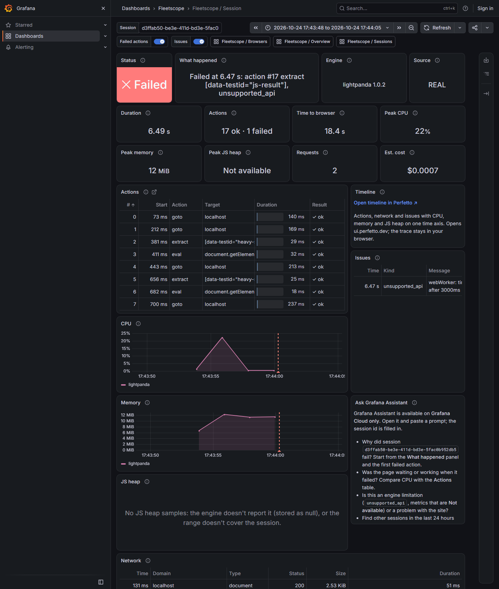
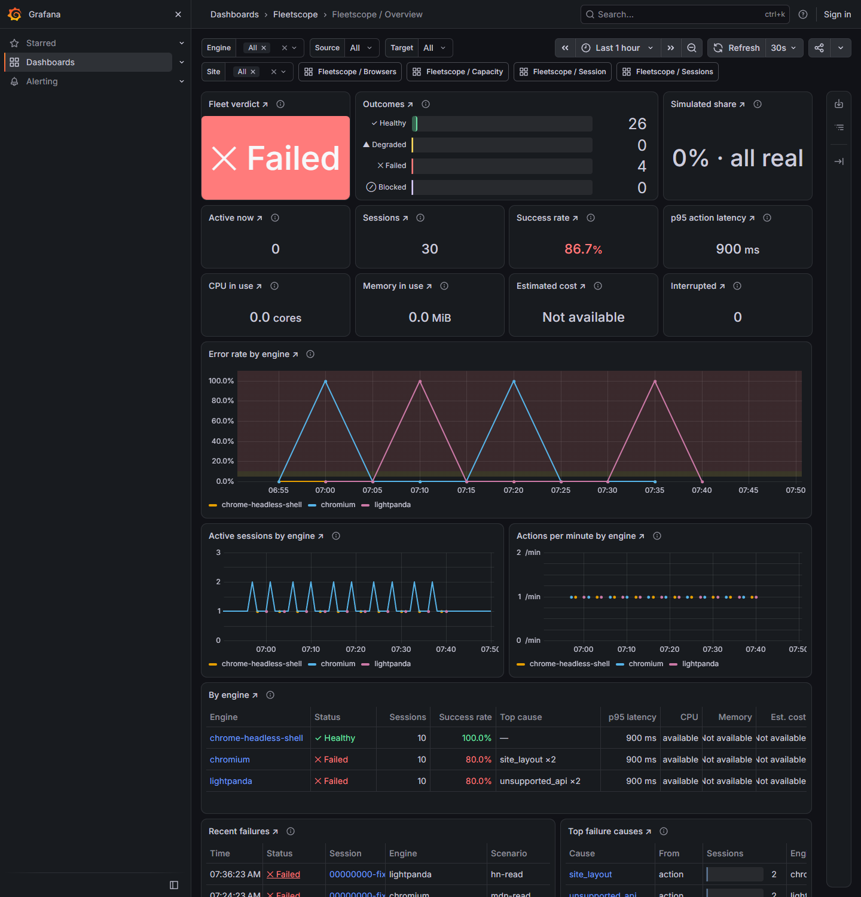
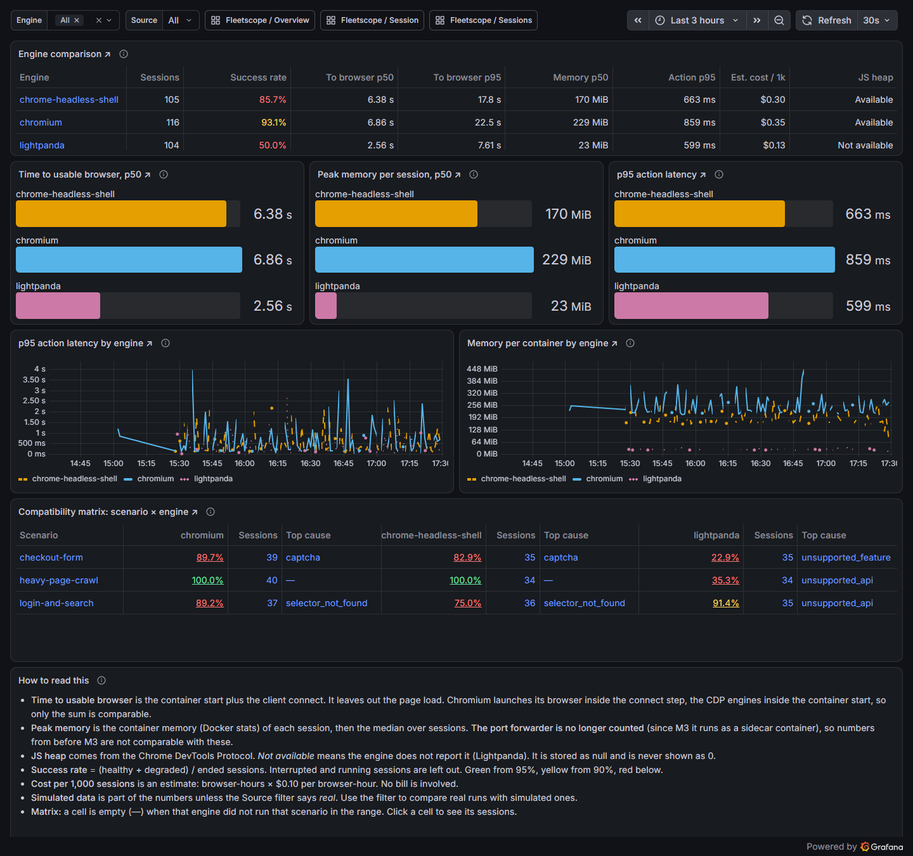
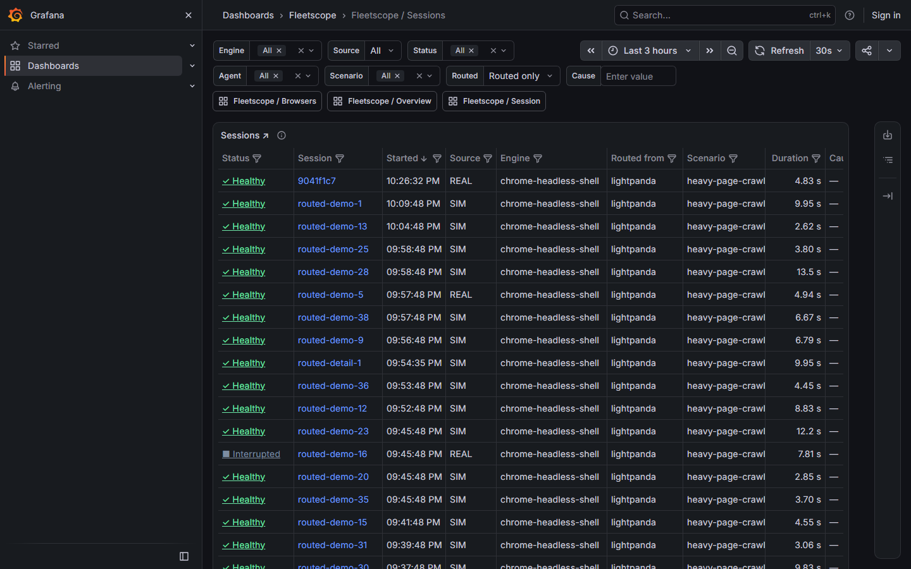
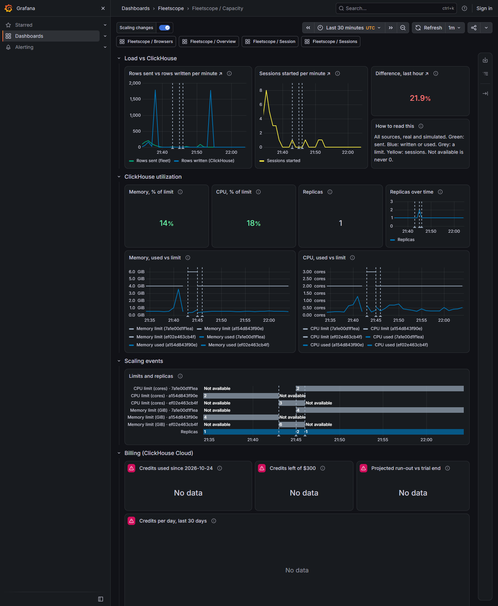
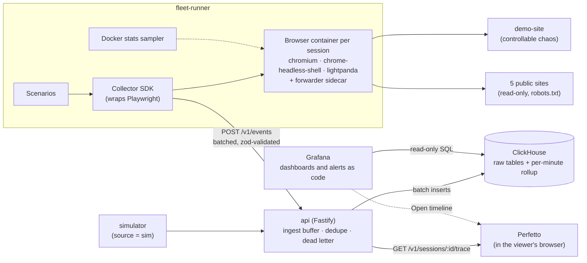

# Fleetscope

**Observability for AI browser fleets.** Fleetscope runs real browser sessions across three engines
(Chromium, chrome-headless-shell and Lightpanda), records what every browser did and what it cost,
and answers in Grafana: *is the fleet healthy, why did this session fail, and which engine should
run which work?*

[](https://github.com/EyalDassa/fleetscope/actions/workflows/ci.yml)



<sub>A real Lightpanda session that failed on a page using Web Workers. The dashboard names the
failing action and the cause, shows CPU and memory around it, and marks what the engine doesn't
report as "Not available" instead of 0.</sub>

---

## The problem

Teams running AI agents on browser fleets have very little visibility into what the browsers are
doing. When an agent is slow, gets blocked, crashes or burns money, they dig through logs one
session at a time. Fleetscope is built around the questions those teams ask:

| Who | Question | Where it's answered |
|---|---|---|
| Platform / DevOps | Is the fleet healthy right now? | **Overview** dashboard |
| Agent developer | Why did this session fail or run slowly? | **Session** dashboard + Perfetto timeline |
| Agent developer / DevOps | Which engine should we run, and for which sites? | **Browsers** dashboard |
| Platform / finance | Is the database keeping up, and what is it costing? | **Capacity** dashboard + alerts |

Two rules run through the whole project:

- **Simulated data is always labeled.** Every event carries `source: "real" | "sim"`, and every
  dashboard can filter on it and shows how much of a number is simulated.
- **Engine gaps are never faked.** A metric an engine can't report is stored as `null` and shown as
  "Not available", never as 0. A missing browser feature fails the session with its own error code.

## What was built

| | |
|---|---|
| **Real browser fleet** | Every session gets a fresh Docker container for its engine plus a small port-forwarder sidecar, so the container's CPU and memory belong to exactly one session. Three scenarios run against a purpose-built demo site with controllable chaos (slow pages, flaky elements, a bot wall, a JS-heavy page), and read-only journeys run against five real public sites. |
| **Collector SDK** | Wraps Playwright: times every action, reads CDP metrics and network events where the engine supports them, classifies failures into a fixed set of error codes, and batches events with retries. |
| **Ingest API** | Fastify. `POST /v1/events` validates batches with zod, buffers them, and writes to ClickHouse in batches about once a second. Retries are deduplicated, and a batch ClickHouse will never accept goes to a dead-letter file instead of blocking everyone. |
| **ClickHouse data model** | Raw event tables with a 30-day TTL, a per-minute rollup maintained by materialized views, and a pricing table for estimated cost. |
| **Grafana dashboards, as code** | Overview, Sessions, Session, Browsers and Capacity, stored as JSON in the repo. Grafana reads ClickHouse directly as a read-only user. CI executes every panel's SQL against seeded data. |
| **Perfetto timeline** | The API serves any session as a Chrome trace, so its actions, network requests and issues line up with CPU, memory and JS heap in [Perfetto](https://ui.perfetto.dev). The trace is processed in the viewer's browser, not uploaded. |
| **Routing by scenario** | When an engine lacks a feature a scenario needs (Lightpanda never runs Web Workers), the session runs on the lightest capable engine instead, and the dashboards show it was routed. |
| **Simulator** | Generates synthetic traffic from a profile calibrated on real sessions, always labeled `sim`. |
| **Capacity monitoring and alerts** | Rows sent vs rows ClickHouse actually wrote, memory and CPU against the service's limits, scaling events, trial credit from the ClickHouse Cloud billing API. Alert rules are code too. |

### What the data showed

- **Lightpanda uses a fraction of the memory.** On the real public-site sessions (Browsers
  dashboard, 2026-10-25) the median peak memory per session was about **13 MiB** for Lightpanda,
  **128 MiB** for chrome-headless-shell and **221 MiB** for Chromium. Chromium's figure includes about
  110 MiB for Playwright's Node server that runs in its container, and the dashboard says so.
- **But Lightpanda never runs a Web Worker.** It has a `Worker` constructor, but the worker never
  answers. That one gap failed every `heavy-page-crawl` session and pulled Lightpanda's success rate
  to about 56%; without that scenario it was about 84%, close to Chromium's 88%.
  [`tools/worker-probe.mjs`](tools/worker-probe.mjs) reproduces it on the pinned image and on the
  nightly build. That evidence led to routing by scenario
  ([ADR 0005](docs/adr/0005-route-by-scenario.md)) instead of hiding the failures.

## Dashboards

| Overview | Browsers |
|---|---|
| [](infra/grafana/screenshots/overview-1440.png) | [](infra/grafana/screenshots/browsers-1440.png) |
| Fleet verdict, success rate, p95 latency, error rate and active sessions per engine, recent failures and top causes. Every number links to the sessions behind it. | Engines side by side: time to a usable browser, memory, cost per 1,000 sessions, a scenario × engine compatibility matrix and a real-site × engine grid. |

| Sessions | Capacity |
|---|---|
| [](infra/grafana/screenshots/sessions-routed-1440.png) | [](infra/grafana/screenshots/capacity-1440.png) |
| Every session, filterable by status, engine, agent, scenario, source and routing. Each row opens the Session dashboard. | Whether ClickHouse writes what the fleet sends, utilization against the service's limits, scaling events and billing. |

All filters are Grafana variables plus the time picker, so every view is a shareable URL.

## Architecture



| Piece | Path | Stack |
|---|---|---|
| Event schema | [`packages/schema`](packages/schema) | zod, the single definition of every event and error code |
| Collector SDK | [`packages/collector`](packages/collector) | Playwright, CDP |
| Data layer | [`packages/db`](packages/db) | `@clickhouse/client`, migrations, shared queries, the dashboard query rules |
| Ingest API | [`apps/api`](apps/api) | Fastify, pino |
| Fleet runner | [`apps/fleet-runner`](apps/fleet-runner) | Docker Engine API, Playwright |
| Demo site | [`apps/demo-site`](apps/demo-site) | Fastify, server-rendered HTML |
| Simulator | [`apps/simulator`](apps/simulator) | Calibrated log-normal profiles |
| Dashboards and tooling | [`infra/grafana`](infra/grafana) | Grafana 13, ClickHouse and Infinity data sources, push/pull/check CLI |
| Database | [`infra/clickhouse`](infra/clickhouse) | Plain SQL migrations |
| Browser images | [`infra/browsers`](infra/browsers) | Pinned by digest, checked in CI |

TypeScript (strict) throughout, in a pnpm + Turborepo monorepo.

## Engineering highlights

- **Duplicate-safe ingest.** The API drops `event_id`s it has seen in the last 15 minutes, which
  catches client retries. Each flush also carries ClickHouse insert-deduplication tokens, so a flush
  retried after a partial failure doesn't double-count rows. Rows ClickHouse will never accept (a lone UTF-16 surrogate, a
  batch spanning over 100 partitions) go to a dead-letter file instead of stalling ingest for every
  client. [ADR 0002](docs/adr/0002-ingest-dedupe.md)
- **Dashboards are tested code.** The dashboard JSON lives in the repo. `pnpm grafana:check` lints
  it against the design spec, and CI runs every panel's SQL against seeded ClickHouse. Shared SQL
  snippets (what "failed" or "interrupted" means, browser-hours, estimated cost) are copied from
  [`packages/db/README.md`](packages/db/README.md), and CI fails if any copy drifts.
  [ADR 0003](docs/adr/0003-grafana-dashboards.md)
- **Least privilege for Grafana.** Grafana's ClickHouse user is `readonly = 1` with `SELECT` only,
  down to individual system-table columns for the capacity panels. Tests show writes are refused even
  if a write grant were added by mistake. [ADR 0006](docs/adr/0006-capacity-monitoring.md)
- **A fair engine comparison.** Every block of sessions covers every (scenario, engine) pair. The
  port forwarder runs as a sidecar so its memory isn't counted in the browser's. Engines are compared
  on startup + connect time, because Chromium and the CDP engines launch in different phases.
  [ADR 0004](docs/adr/0004-multi-engine-fleet.md)
- **Polite on the real web.** Public-site journeys are read-only, follow each site's robots.txt and
  crawl-delay, pause a site for an hour on a 403, 429 or CAPTCHA, and report a page whose layout
  changed as `site_layout` rather than blaming the browser. A daily canary opens an issue when a
  site's journey fails two days in a row. [ADR 0007](docs/adr/0007-public-sites.md)
- **CI.** Lint, typecheck and unit tests; integration tests against a real ClickHouse; a fleet smoke
  test that starts real browser containers; the dashboard query check; image-pin consistency checks;
  gitleaks over the full history; and Dependabot.

## How it was built

Fleetscope was built in four days (22–25 October 2026) by **Eyal Dassa** as product owner,
working with a team of [Claude Code](https://claude.com/claude-code) subagents. The main Claude Code
session acted as tech lead and delegated to eight agents, each defined in
[`.claude/agents`](.claude/agents) and each owning its own folders:

- **Design:** two competing designers and a design lead.
- **Build:** a backend engineer, a dashboard engineer and a platform engineer.
- **Checks:** a QA engineer and a code reviewer.

The agents never talked to each other directly. Everything went through files in the repo, and that
paper trail is kept:

| Record | Where |
|---|---|
| The plan and the team's rules | [`PLAN.md`](PLAN.md), [`CLAUDE.md`](CLAUDE.md) |
| Design sprint: two proposals, cross-critiques, revisions, the lead's round notes and the final decision per area | [`design/`](design) ([`DECISIONS.md`](design/DECISIONS.md), [`DESIGN.md`](design/DESIGN.md)) |
| Architecture decisions | [`docs/adr/`](docs/adr) |
| QA reports per milestone and feature | [`qa/`](qa) |
| Code reviews per milestone and feature | [`reviews/`](reviews) |
| Plans and decisions per change | The [merged pull requests](https://github.com/EyalDassa/fleetscope/pulls?q=is%3Apr+is%3Amerged) |

Every feedback loop (design critiques, QA and review) got at most two rounds before the lead
decided. A change merged only with green CI, QA's "ready to merge" and the reviewer's approval.

**The mid-project pivot.** The first milestone shipped a custom Next.js dashboard. Once real data was
flowing, it was replaced with Grafana: it does time pickers, variables, sharing and alerting out of
the box, and it is what this product's users already work in. The design sprint's colour and layout
decisions carried over into a Grafana spec. [ADR 0003](docs/adr/0003-grafana-dashboards.md) records why.

### Milestones

| PR | What landed |
|---|---|
| [#1](https://github.com/EyalDassa/fleetscope/pull/1) | **M0:** walking skeleton (monorepo, CI, ClickHouse, migrations) and the design sprint |
| [#4](https://github.com/EyalDassa/fleetscope/pull/4) | **M1:** collector, fleet runner and demo site. The first real Chromium sessions land in ClickHouse |
| [#5](https://github.com/EyalDassa/fleetscope/pull/5) | **M2:** the switch to Grafana; Overview, Sessions and Session dashboards; Perfetto timeline |
| [#6](https://github.com/EyalDassa/fleetscope/pull/6) | **M3:** chrome-headless-shell and Lightpanda, the forwarder sidecar, the Browsers dashboard, the simulator |
| [#8](https://github.com/EyalDassa/fleetscope/pull/8) | Routing by scenario around Lightpanda's Web Worker gap |
| [#9](https://github.com/EyalDassa/fleetscope/pull/9) | Capacity dashboard, billing data source and alerts as code |
| [#10](https://github.com/EyalDassa/fleetscope/pull/10), [#11](https://github.com/EyalDassa/fleetscope/pull/11) | Real public sites next to the demo site, and their daily canary |
| [#12](https://github.com/EyalDassa/fleetscope/pull/12), [#13](https://github.com/EyalDassa/fleetscope/pull/13), [#14](https://github.com/EyalDassa/fleetscope/pull/14) | Real sites × engines grid, public-site rotation across every engine, success rate by engine over time |

By the numbers: 265 commits, 11 merged pull requests, 7 ADRs, and about 1,700 test cases in
128 test files (30 of them integration tests against a real ClickHouse).

### Planned but not built

[`PLAN.md`](PLAN.md) is the original plan and goes further than what was built. Not built yet:
the Insights and Usage-and-cost dashboards, the MCP server and public REST API for AI agents, Sentry,
and running Chromium over plain CDP (to remove the Playwright server from its memory numbers).

## Run it locally

You need Docker, Node.js 22+ and pnpm. The first Grafana start needs internet once, to download the
ClickHouse plugin.

```bash
pnpm install
cp .env.example .env               # development defaults; the ClickHouse Cloud keys are optional

pnpm infra:up                      # ClickHouse + Grafana
pnpm db:migrate                    # create the tables
pnpm db:grafana-user               # once: the read-only user Grafana connects as

pnpm browsers:build                # the Chromium image and the forwarder sidecar
pnpm browsers:pull                 # chrome-headless-shell and Lightpanda (pinned by digest)

pnpm dev                           # api on :4000 and demo site on :3100, keep it running
```

In a second terminal, run some real sessions and, optionally, simulated traffic:

```bash
pnpm fleet run --engines chromium,chrome-headless-shell,lightpanda --sessions 9 --concurrency 3
pnpm sim run --sessions 500 --duration 10m     # optional, labeled as simulated
```

Then open Grafana at <http://127.0.0.1:3001> and pick a dashboard in the **Fleetscope** folder.
Anyone can view; to edit, sign in as `admin` with `GRAFANA_ADMIN_PASSWORD` from `.env`.

More options: [`apps/fleet-runner`](apps/fleet-runner/README.md) (continuous traffic, routing,
public sites), [`apps/simulator`](apps/simulator/README.md) (live mode, calibration) and
[`infra/grafana`](infra/grafana/README.md) (editing dashboards, deploying to Grafana Cloud, alerts).

### Tests

```bash
pnpm lint && pnpm typecheck && pnpm test     # unit tests
pnpm test:integration                        # against the ClickHouse from `pnpm infra:up`
pnpm grafana:check                           # dashboard rules
```

## Repository map

```
apps/          api · fleet-runner · demo-site · simulator
packages/      schema · collector · db
infra/         clickhouse migrations · grafana dashboards, alerts and tooling · browser images · docker-compose
docs/adr/      architecture decision records
design/        design brief, both proposals, critiques and the final design spec
qa/  reviews/  QA reports and code reviews per milestone
tools/         worker-probe.mjs (the Lightpanda Web Worker check)
.claude/       the subagent definitions the project was built with
```
