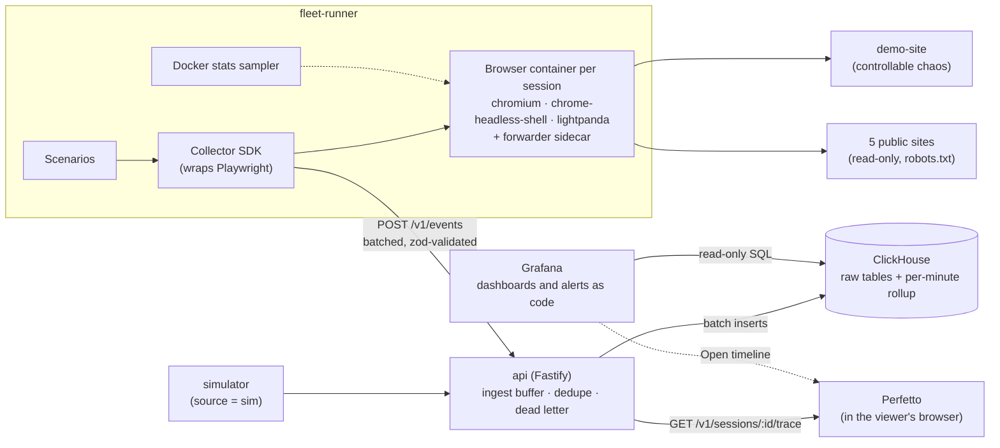

# Fleetscope

**Observability for AI browser fleets.** Fleetscope runs real browser sessions across three engines
(Chromium, chrome-headless-shell and Lightpanda), records what every browser did and what it cost,
and answers in Grafana: *is the fleet healthy, why did this session fail, and which engine should
run which work?*

[](https://github.com/EyalDassa/fleetscope/actions/workflows/ci.yml)


<sub>A real Lightpanda session that failed on a page using Web Workers. The dashboard names the
failing action and the cause, shows CPU and memory around it, and marks what the engine doesn't
report as "Not available" instead of 0.</sub>

---

## What it does

AI agents that drive headless browsers fail in ways that are hard to see: a page is slow, a site
blocks the bot, an engine lacks a Web API, a browser sits idle while it's billed. Without telemetry,
the only way to find out is to read logs one session at a time.

Fleetscope collects a structured event stream from every browser session and turns it into four
dashboards:

| Question | Where it's answered |
|---|---|
| Is the fleet healthy right now? | **Overview** |
| Why did this session fail, or run slowly? | **Session**, plus a Perfetto timeline |
| Which engine should run which work, and on which sites? | **Browsers** |
| Is the database keeping up, and what is it costing? | **Capacity**, plus alerts |

Two rules run through the whole project:

- **Simulated data is always labeled.** Every event carries `source: "real" | "sim"`, and every
  dashboard can filter on it and shows how much of a number is simulated.
- **Engine gaps are never faked.** A metric an engine can't report is stored as `null` and shown as
  "Not available", never as 0. A missing browser feature fails the session with its own error code.

## Features

| | |
|---|---|
| **Real browser fleet** | Every session gets a fresh Docker container for its engine plus a small port-forwarder sidecar, so the container's CPU and memory belong to exactly one session. Three scenarios run against a purpose-built demo site with controllable chaos (slow pages, flaky elements, a bot wall, a heavy page, a JS-heavy page), and read-only journeys run against five real public sites. |
| **Collector SDK** | Wraps Playwright: times every action, reads CDP metrics and network events where the engine supports them, classifies failures into a fixed set of error codes, and batches events with retries. |
| **Ingest API** | `POST /v1/events` validates batches, buffers them, and writes to ClickHouse in batches about once a second. Retries are deduplicated, and a batch ClickHouse will never accept goes to a dead-letter file instead of blocking ingest. |
| **ClickHouse data model** | Raw event tables with a 30-day TTL, a per-minute rollup maintained by materialized views, and a pricing table for estimated cost. |
| **Dashboards as code** | Overview, Sessions, Session, Browsers and Capacity, stored as JSON in the repo. Grafana reads ClickHouse directly as a read-only user, and CI executes every panel's SQL against seeded data. |
| **Session timeline** | The API serves any session as a Chrome trace, so its actions, network requests and issues line up with CPU, memory and JS heap in [Perfetto](https://ui.perfetto.dev). The trace is processed in the viewer's browser, not uploaded. |
| **Routing by scenario** | When an engine lacks a feature a scenario needs (Lightpanda never runs Web Workers), the session runs on the lightest capable engine instead, and the dashboards show it was routed. |
| **Simulator** | Generates synthetic traffic from a profile calibrated on real sessions, always labeled `sim`. |
| **Capacity monitoring and alerts** | Rows sent vs rows ClickHouse actually wrote, memory and CPU against the service's limits, scaling events, and credit from the ClickHouse Cloud billing API. Alert rules are code too. |

## What the data shows

- **Lightpanda uses a fraction of the memory.** On real public-site sessions (Browsers dashboard,
  2026-10-25) the median peak memory per session was about **13 MiB** for Lightpanda,
  **128 MiB** for chrome-headless-shell and **221 MiB** for Chromium. Chromium's figure includes about
  110 MiB for Playwright's Node server that runs in its container, and the dashboard says so.
- **But Lightpanda never runs a Web Worker.** It has a `Worker` constructor, but the worker never
  answers. That one gap failed every `heavy-page-crawl` session and pulled Lightpanda's success rate
  to about 56%; without that scenario it was about 84%, close to Chromium's 88%.
  [`tools/worker-probe.mjs`](tools/worker-probe.mjs) reproduces it on the pinned image and on the
  nightly build. That led to routing by scenario ([ADR 0005](docs/adr/0005-route-by-scenario.md))
  instead of hiding the failures.

## Dashboards

| Overview | Browsers |
|---|---|
| [](infra/grafana/screenshots/overview-1440.png) | [](infra/grafana/screenshots/browsers-1440.png) |
| Fleet verdict, success rate, p95 latency, error rate and active sessions per engine, recent failures and top causes. Every number links to the sessions behind it. | Engines side by side: time to a usable browser, memory, cost per 1,000 sessions, a scenario × engine compatibility matrix and a real-site × engine grid. |

| Sessions | Capacity |
|---|---|
| [](infra/grafana/screenshots/sessions-routed-1440.png) | [](infra/grafana/screenshots/capacity-1440.png) |
| Every session, filterable by status, engine, agent, scenario, source and routing. Each row opens the Session dashboard. | Whether ClickHouse writes what the fleet sends, utilization against the service's limits, scaling events and billing. |

All filters are Grafana variables plus the time picker, so every view is a shareable URL.

## Architecture



| Piece | Path | What it is |
|---|---|---|
| Event schema | [`packages/schema`](packages/schema) | The single definition of every event and error code |
| Collector SDK | [`packages/collector`](packages/collector) | Instruments a Playwright browser and ships events |
| Data layer | [`packages/db`](packages/db) | ClickHouse client, migrations, shared queries and the dashboard query rules |
| Ingest API | [`apps/api`](apps/api) | Event ingest and the session trace |
| Fleet runner | [`apps/fleet-runner`](apps/fleet-runner) | Starts browser containers and runs scenarios |
| Demo site | [`apps/demo-site`](apps/demo-site) | A target site with controllable failures |
| Simulator | [`apps/simulator`](apps/simulator) | Synthetic traffic from a calibrated profile |
| Dashboards and tooling | [`infra/grafana`](infra/grafana) | Dashboard and alert JSON, plus the push/pull/check CLI |
| Database | [`infra/clickhouse`](infra/clickhouse) | Plain SQL migrations |
| Browser images | [`infra/browsers`](infra/browsers) | The Chromium and forwarder images, and the pinned upstream engines |

## Tech stack, and why

| Technology | Used for | Why |
|---|---|---|
| **ClickHouse** | All telemetry | The workload is append-only events read by aggregation ("p95 latency per engine per minute"). A columnar store compresses repetitive columns well, runs those queries in milliseconds and is built for batch inserts. Postgres with TimescaleDB was the alternative; Postgres is still the better fit for app metadata such as users and API keys. [ADR 0001](docs/adr/0001-clickhouse.md) |
| **Grafana** | The UI, alerts | Time picker, variables, shareable URLs, auto-refresh and alerting come built in, and it's what people running infrastructure already use. Reading ClickHouse directly through the official data source was faster to build than a custom dashboard or a Grafana-over-API setup. [ADR 0003](docs/adr/0003-grafana-dashboards.md) |
| **Perfetto** | Session timeline | Grafana has no Gantt view. Perfetto shows action slices next to CPU and memory counters on one axis, and browser engineers already know it. |
| **Playwright** | Driving the browsers | One API for all three engines: `connect` for Chromium and `connectOverCDP` for the other two. |
| **Docker, one container per session** | Isolation and measurement | Container stats give per-session CPU, memory and network for every engine, including engines with no CDP performance metrics, and `startup_ms` becomes a real per-engine number. [ADR 0004](docs/adr/0004-multi-engine-fleet.md) |
| **Chromium, chrome-headless-shell, Lightpanda** | The engines compared | Chromium is the baseline, headless-shell is Google's lighter headless build, and Lightpanda is a from-scratch engine built for automation with a very small footprint and incomplete Web API coverage. Each is pinned by digest. |
| **Fastify + zod** | Ingest API and validation | Fast, small and TypeScript-friendly. The zod schemas in `packages/schema` are the only definition of the event shapes, shared by the collector, API and simulator. |
| **TypeScript, pnpm, Turborepo** | The monorepo | One language end to end, strict types across package boundaries, and cached builds and tests per package. |
| **Vitest, Biome** | Tests, lint and format | Fast and simple to configure in a monorepo. |
| **GitHub Actions, gitleaks, Dependabot** | CI | Lint, typecheck, unit and integration tests, a fleet smoke test with real browser containers, the dashboard query check, a secret scan over the full history, and dependency updates. |
| **Grafana Cloud, ClickHouse Cloud** | Hosted deployment | Grafana Cloud's free tier for the dashboards and Grafana Assistant; ClickHouse Cloud because a hosted Grafana needs a ClickHouse it can reach. The same dashboards run locally against docker-compose. |

## Engineering details

- **Duplicate-safe ingest.** The API drops `event_id`s it has seen in the last 15 minutes, which
  catches client retries. Each flush also carries ClickHouse insert-deduplication tokens, so a flush
  retried after a partial failure doesn't double-count rows. Rows ClickHouse will never accept (a lone
  UTF-16 surrogate, a batch spanning over 100 partitions) go to a dead-letter file instead of stalling
  ingest for every client. [ADR 0002](docs/adr/0002-ingest-dedupe.md)
- **Dashboards are tested code.** `pnpm grafana:check` lints the dashboard JSON against the design
  spec, and CI runs every panel's SQL against seeded ClickHouse. Shared SQL snippets (what "failed" or
  "interrupted" means, browser-hours, estimated cost) are copied from
  [`packages/db/README.md`](packages/db/README.md), and CI fails if any copy drifts.
- **Least privilege for Grafana.** Grafana's ClickHouse user is `readonly = 1` with `SELECT` only,
  down to individual system-table columns for the capacity panels. Tests show writes are refused even
  if a write grant were added by mistake. [ADR 0006](docs/adr/0006-capacity-monitoring.md)
- **A fair engine comparison.** Every block of sessions covers every (scenario, engine) pair. The
  port forwarder runs as a sidecar so its memory isn't counted in the browser's. Engines are compared
  on startup + connect time, because Chromium and the CDP engines launch in different phases.
  [ADR 0004](docs/adr/0004-multi-engine-fleet.md)
- **Polite on the real web.** Public-site journeys are read-only, follow each site's robots.txt and
  crawl-delay, pause a site for an hour on a 403, 429 or CAPTCHA, and report a page whose layout
  changed as `site_layout` rather than blaming the browser. A daily canary opens an issue when a
  site's journey fails two days in a row. [ADR 0007](docs/adr/0007-public-sites.md)

## Run it locally

You need Docker, Node.js 22+ and pnpm. The first Grafana start needs internet once, to download the
ClickHouse plugin.

```bash
pnpm install
cp .env.example .env               # development defaults; the ClickHouse Cloud keys are optional

pnpm infra:up                      # ClickHouse + Grafana
pnpm db:migrate                    # create the tables
pnpm db:grafana-user               # once: the read-only user Grafana connects as

pnpm browsers:build                # the Chromium image and the forwarder sidecar
pnpm browsers:pull                 # chrome-headless-shell and Lightpanda (pinned by digest)

pnpm dev                           # api on :4000 and demo site on :3100, keep it running
```

In a second terminal, run some real sessions and, optionally, simulated traffic:

```bash
pnpm fleet run --engines chromium,chrome-headless-shell,lightpanda --sessions 9 --concurrency 3
pnpm sim run --sessions 500 --duration 10m     # optional, labeled as simulated
```

Then open Grafana at <http://127.0.0.1:3001> and pick a dashboard in the **Fleetscope** folder.
Anyone can view; to edit, sign in as `admin` with `GRAFANA_ADMIN_PASSWORD` from `.env`.

More options: [`apps/fleet-runner`](apps/fleet-runner/README.md) (continuous traffic, routing,
public sites), [`apps/simulator`](apps/simulator/README.md) (live mode, calibration) and
[`infra/grafana`](infra/grafana/README.md) (editing dashboards, deploying to Grafana Cloud, alerts).

### Tests

```bash
pnpm lint && pnpm typecheck && pnpm test     # unit tests
pnpm test:integration                        # against the ClickHouse from `pnpm infra:up`
pnpm grafana:check                           # dashboard rules
```

## Roadmap

- An Insights dashboard: slowest sites, block rates per domain, memory-leak suspects, idle sessions
  that are still billed, error spikes.
- A usage and cost dashboard by engine, agent and scenario.
- An MCP server and a read-only REST API, so AI agents can ask the same questions programmatically.
- Chromium over plain CDP, to take Playwright's server out of its memory numbers.

## Repository map

```
apps/          api · fleet-runner · demo-site · simulator
packages/      schema · collector · db
infra/         clickhouse migrations · grafana dashboards, alerts and tooling · browser images · docker-compose
docs/adr/      architecture decision records
design/        the dashboard design spec and the design proposals behind it
qa/  reviews/  test reports and code reviews per feature
tools/         worker-probe.mjs (the Lightpanda Web Worker check)
```
